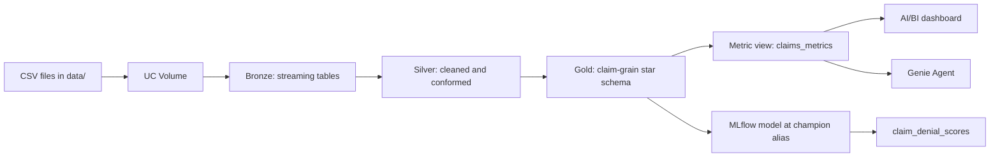
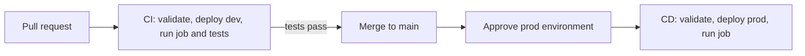

# Payer Claims Lakehouse with Genie (Databricks)

[](https://github.com/chetanp1390/payer-medallion-lakeflow/actions/workflows/ci.yml)
[](https://github.com/chetanp1390/payer-medallion-lakeflow/actions/workflows/cd.yml)

An end-to-end prototype of a payer-side healthcare analytics platform on Databricks, built on **synthetic** claims data. Raw files flow through a Lakeflow medallion pipeline into a claim-grain star schema, a Unity Catalog **metric view** defines the KPIs once, and an **AI/BI dashboard**, a **Genie Agent** and an **MLflow** denial model all read from that single definition. The whole project is code: it deploys as a Declarative Automation Bundle (formerly Databricks Asset Bundles) through **GitHub Actions** CI/CD with dev and prod targets.

> **Status:** working prototype on Databricks Free Edition. Genie Agent instruction tuning and a Streamlit app on the Genie Conversation API are in progress (see [Roadmap](#roadmap)).

## Architecture



Everything lives in Unity Catalog under one catalog (`payer_demo`) with one schema per layer, so access can be granted per layer: analysts on gold, engineers on silver, raw bronze locked down.

## What is in the project

| Layer | What it does | Where |
| --- | --- | --- |
| Ingestion | Loads the CSVs into a governed UC Volume; creates catalog, schemas and volume | `src/setup/00_setup.py` |
| Bronze | Streams raw CSVs into tables with explicit schemas (no inference drift) | `src/transformations/01_bronze.py` |
| Silver | Cleans and conforms: null-key filters, trimmed text, lowercase claim status, `$` amounts cast to numbers | `src/transformations/02_silver.py` |
| Gold | Claim-grain star schema with keys and comments, plus the original aggregate tables | `src/transformations/03_gold.py` |
| Semantic layer | Metric view `claims_metrics` and trusted SQL function `top_providers_by_denial_rate` | `src/setup/05_semantic_layer.py` |
| Data tests | Grain, tie-out, volume and status checks; a failure fails the job and CI | `src/tests/06_data_tests.py` |
| Dashboard | Payer Claims Overview: KPIs, monthly trends, charges by specialty, four filters | `src/dashboards/payer_dashboard.lvdash.json` |
| Genie Agent | Payer Claims Analyst over the metric view and star schema, with 12 benchmark questions | `src/genie/payer_genie.geniespace.json` |
| ML | Denial classifier tracked with MLflow, registered in UC as `@champion`, batch-scored to gold | `src/ml/07_claim_denial_model.py` |
| Deployment | Bundle with dev/prod targets; CI and CD workflows | `databricks.yml`, `resources/`, `.github/workflows/` |

## Data

All data is synthetic and contains no PHI. Provider NPIs start with `9` so none can match a real provider.

| File | Rows | Notes |
| --- | --- | --- |
| `claims.csv` | 15,000 | Jan 2023 to Dec 2024; status `PAID`, `DENIED` or `PENDING` |
| `members.csv` | 2,500 | Five plans (`PLN101` to `PLN105`), ages 0 to 85 |
| `providers.csv` | 150 | 12 specialties, mostly Kentucky plus neighbouring states |
| `procedures.csv` | ~23,500 | CPT codes; claim charge equals the sum of its procedure lines |
| `diagnosis.csv` | ~22,600 | ICD-10 codes, one to three per claim |

The generator plants a few known patterns, so the dashboard, Genie and the model can be tested against answers that are known in advance. For example, Cardiology denials step up from about 20% to about 34% from July 2024, and denial rates vary by plan and by in-state versus out-of-state provider.

## Gold layer design

The original `claims_enriched` table joins claims to diagnoses, so a claim with three diagnoses appears three times and summing `total_charge` triple-counts it. The gold layer fixes the **grain** with a star schema:

| Table | One row per | Role |
| --- | --- | --- |
| `fact_claims` | claim | The only table that is safe to sum charges from; includes `diagnosis_count` |
| `dim_member` | member | Gender and plan. Names are deliberately excluded (minimum necessary) |
| `dim_provider` | provider | Specialty and location |
| `claim_diagnosis` | claim and diagnosis | Diagnosis questions, counted with `COUNT(DISTINCT claim_id)` |

Every table and column has a comment, and primary and foreign keys are declared, because Genie reads this metadata to write its SQL. `claims_enriched` stays for backward compatibility, with a comment warning against summing it.

## Semantic layer

`claims_metrics` is a Unity Catalog metric view on `fact_claims`, joined to both dimensions. It defines each KPI once:

- **Measures:** claim count, total charges, average charge per claim, members with claims, charges per member, denied claims, denial rate
- **Dimensions:** claim date and month, status, plan, member gender, provider specialty, state and name
- **Agent metadata:** display names and synonyms (for example "rejection rate" maps to denial rate), so Genie matches business language

Ratios are computed at query time, so denial rate is correct at any grouping, which pre-aggregated tables cannot guarantee. A data test reconciles the metric view's total charges with the underlying table on every run.

## Genie Agent

**Payer Claims Analyst** answers natural-language questions over `claims_metrics`, `fact_claims`, `dim_member`, `dim_provider` and `claim_diagnosis`. The fan-out table is deliberately excluded. Join relationships come from the declared keys.

Quality is measured with **12 benchmark questions**, each with ground-truth SQL, including synonym tests and two fan-out traps. The first run scored 58%. Reviewing the failures showed most were answer-key and formatting differences rather than wrong numbers (for example 0.144 against 14.4); after correcting the answer keys the run scored 83% (10 of 12). Instruction and example-query tuning is the next step.

## Machine learning

`07_claim_denial_model.py` trains a logistic regression denial classifier on fields known before adjudication only (no leakage). It tracks the run with MLflow, registers the model in Unity Catalog as `payer_demo.payor_gold.claim_denial_model`, promotes the newest version with the `@champion` alias, and writes per-claim risk scores to `claim_denial_scores`.

On this synthetic data the AUC is about 0.65. The point of the notebook is the governed lifecycle, not the model; with real claims, features such as procedure codes, prior denials and prior-authorization flags would carry the signal.

The notebook runs on demand and is not part of the scheduled job.

## Deployment and CI/CD

The project is a **Declarative Automation Bundle** with two targets in the same workspace, kept apart by schema names:

| Target | Schemas | Deploys |
| --- | --- | --- |
| `dev` | `dev_payor_*` | Pipeline and job, with names prefixed `[dev <user>]` |
| `prod` | `payor_*` | Pipeline, job, dashboard and Genie Agent |

The dashboard and Genie Agent deploy to prod only, because their SQL names `payer_demo.payor_gold` directly. Parameterizing them for dev is on the roadmap.

The `payer_refresh` job runs the whole refresh in order:

```text
setup  ->  pipeline  ->  semantic_layer  ->  data_tests
```

GitHub Actions automate delivery:



- **`ci.yml`** runs on every pull request into `main`: validate, deploy to dev, run the job including the data tests. A failed test fails the check, and branch protection blocks the merge.
- **`cd.yml`** runs on every push to `main`: it waits for approval through the `prod` GitHub environment, then deploys to prod and runs the job.
- Each workflow has its own concurrency group: a newer push to a pull request cancels that PR's older CI run, and prod deploys queue one at a time. A dev and a prod run can overlap; if Free Edition refuses a second pipeline update, rerun the failed job.

Authentication uses a personal access token stored as a GitHub secret, because Free Edition has no account console. In a production organisation this would be a service principal with GitHub OIDC workload identity federation, so no long-lived secret is stored.

## Run it yourself

**Prerequisites:** a Databricks workspace (Free Edition works), the Databricks CLI version 1.3.0 or newer (needed for Genie Agents in bundles), and a personal access token.

1. Clone the repo and point the CLI at your workspace:

    ```bash
    git clone https://github.com/chetanp1390/payer-medallion-lakeflow.git
    cd payer-medallion-lakeflow
    databricks configure        # host + personal access token
    ```

2. Change the `host` values in `databricks.yml` to your workspace URL. If your SQL warehouse isn't called `Serverless Starter Warehouse`, change the `warehouse_id` lookup too.
3. Deploy and run in dev:

    ```bash
    databricks bundle validate
    databricks bundle deploy -t dev
    databricks bundle run payer_refresh -t dev
    ```

4. Deploy to prod the same way with `-t prod`. The dashboard and Genie Agent expect the default catalog and schema names (`payer_demo.payor_gold`).
5. Optionally, run `src/ml/07_claim_denial_model.py` as a notebook to train and register the model.

**To enable CI/CD on a fork:** add a repository secret `DATABRICKS_TOKEN` and a repository variable `DATABRICKS_HOST`, create a `prod` environment with required reviewers, and protect `main` with the `dev` status check.

## Repository layout

```text
.
├── databricks.yml                     # bundle: variables, dev/prod targets, prod-only BI assets
├── resources/
│   ├── payer_pipeline.pipeline.yml    # Lakeflow pipeline
│   └── payer_refresh.job.yml          # setup -> pipeline -> semantic layer -> data tests
├── src/
│   ├── transformations/               # 01_bronze.py, 02_silver.py, 03_gold.py
│   ├── setup/                         # 00_setup.py, 05_semantic_layer.py
│   ├── tests/                         # 06_data_tests.py
│   ├── ml/                            # 07_claim_denial_model.py
│   ├── dashboards/                    # payer_dashboard.lvdash.json
│   └── genie/                         # payer_genie.geniespace.json
├── data/                              # synthetic CSVs
└── .github/workflows/                 # ci.yml, cd.yml
```

## Design decisions

- **Fix the grain before adding AI.** Genie and dashboards repeat whatever the tables say, so the claim-grain fact table came before any natural-language layer.
- **One definition per KPI.** The metric view owns the math; the dashboard, Genie and data tests all read it.
- **Metadata is part of the model.** Comments, keys and synonyms are what the Genie Agent reasons over.
- **Separation of concerns per layer.** Bronze preserves, silver conforms, gold serves. Failures are isolated to a layer, and layers can be reprocessed independently.
- **Governance first.** Schema-per-layer under Unity Catalog; the Volume keeps raw files governed too; PHI-like fields (names) stay out of the AI-facing tables.
- **Explicit schemas in bronze** avoid per-file inference cost and cross-file drift.
- **Tests run in CI.** Grain, tie-out and volume checks run on every pull request, so a broken change fails in dev, not prod.

## Roadmap

1. **Genie Agent tuning:** general instructions, parameterized example queries and the trusted SQL function as an agent asset; rerun benchmarks after each change.
2. **Streamlit app** on the Genie Conversation API, deployed as a Databricks App.
3. **Lakebase review worklist:** serve denied claims to the app through a synced table, and record reviewer decisions in Postgres registered back in Unity Catalog.
4. **Dev copies of BI assets** by parameterizing the dashboard and Genie Agent catalog and schema.
5. **Auto Loader** (`cloudFiles`) in bronze for incremental file discovery at scale.
6. **AUTO CDC with SCD Type 2** on the members dimension to preserve member history.
7. **Lakeflow expectations** for positive charges, non-null keys and valid status values, with quality metrics published to Unity Catalog.
8. **Service principal with OIDC** for CI/CD in a production workspace.

## License

MIT. See [LICENSE](LICENSE).
